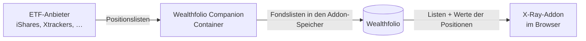

# X-Ray für Wealthfolio

Zeigt in [Wealthfolio](https://wealthfolio.app), was in deinen ETFs steckt: jede Aktie einmal über alle Konten, mit ihrem Anteil am Depot, wie stark sich deine ETFs überschneiden und wo Klumpenrisiken liegen (eine Aktie, ein Land, ein Sektor, Fremdwährung, Bargeld auf einem Konto).

Die Fondslisten holt das Addon nicht selbst: Es **geht nicht ins Netz**. Sie kommen vom [Wealthfolio Companion](https://github.com/waldonso2/wealthfolio-companion), der sie bei den Anbietern abruft und in Wealthfolio ablegt. Die Werte deiner Positionen liest das Addon direkt aus Wealthfolio. Beträge verlassen Wealthfolio nie.



## Installation

1. Wealthfolio **3.11** oder neuer.
2. In Wealthfolio Companion auf der Seite *Dienste* **X-Ray in Wealthfolio** einschalten. Nach dem nächsten Abruf liegen die Listen in Wealthfolio.
3. Die Datei `wealthfolio-companion-addon-xray.zip` aus dem [neuesten Release](https://github.com/waldonso2/wealthfolio-companion-addon-xray/releases/latest) laden und in Wealthfolio unter *Einstellungen → Add-ons → Install from File* installieren.

Das Addon fragt nach drei Rechten: Konten und Positionen lesen, eine Seite in der Seitenleiste. Es schreibt nichts in Wealthfolio außer den eigenen Einstellungen (Grenzen der Klumpenrisiken, „Bewusst so“).

## Entwickeln

```bash
pnpm install
pnpm type-check && pnpm lint && pnpm test:coverage   # Tests, auch gegen die Rechenfälle des Dienstes
pnpm build && pnpm test:ui                           # Testseite mit Beispieldaten im Browser (axe, CSP, Handy)
pnpm bundle                                          # dist/wealthfolio-companion-addon-xray.zip
```

`pnpm dev` zeigt die Seite mit erfundenen Beispieldaten ohne Wealthfolio. Wie Dienst und Addon die Daten teilen, steht in [`contract/xray/README.md`](contract/xray/README.md). Die Kopie im Dienst ist maßgeblich.

Entstanden am Handy, im Gespräch mit Claude.

## Lizenz

MIT
